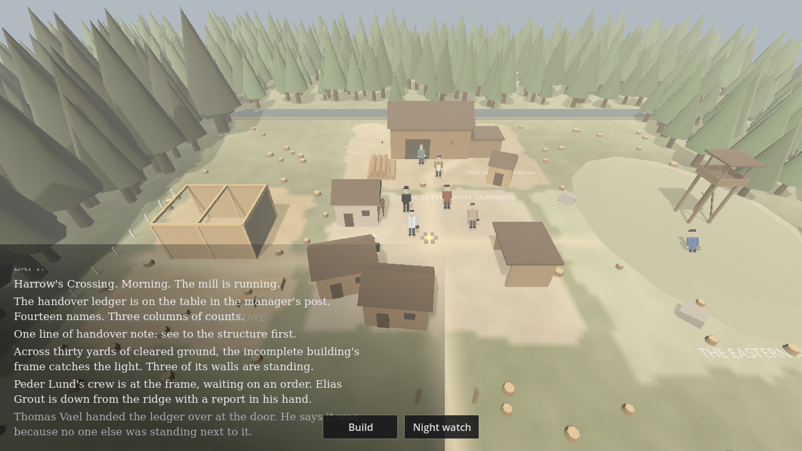
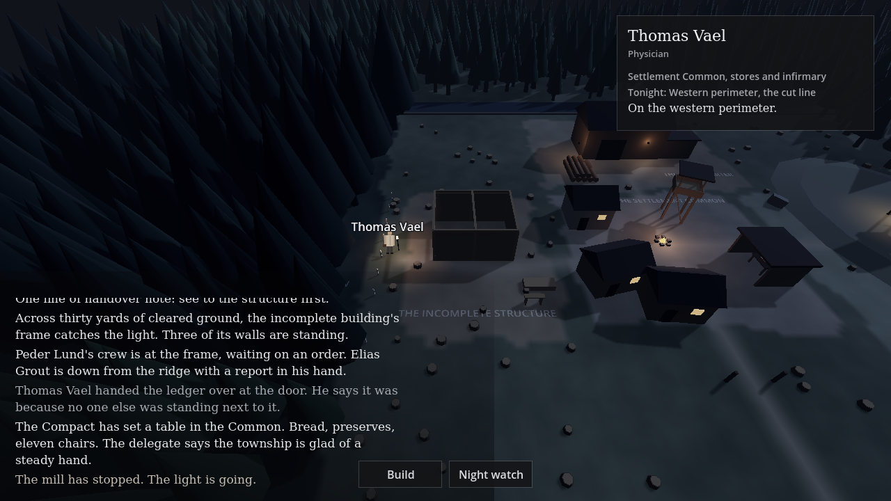

# Hollow Township — Chapter One (Godot 4 build)

A complete, offline, playable **Chapter 1: Harrow's Crossing** — five days, five nights —
built from the frozen design docs in `../design/`. The simulation layer (logistics) is the
gameplay surface; the horror is the consequence layer that arrives at night, traceable to
what the player did during the day.

> **Earned Dread** — *every right choice arrives already compromised.*




---

## Run it

1. Install **Godot 4.3** or newer (standard build; no C#/.NET).
2. Project Manager → **Import** → `godot/project.godot` → **Play** (F5).

The project uses the **Compatibility** renderer (OpenGL), so the same build targets desktop,
web and mobile (CONCEPT.md platform sequence). No assets are shipped: every texture, mesh and
sound is generated in code.

### Controls

| Action | Input |
|--------|-------|
| Pan / turn / zoom | W A S D or arrows / Q E or middle-drag / wheel or `=` `-` |
| Select a person, the ledger, the board | Left click |
| Build list / Night watch roster | B / R (or the two buttons, bottom centre) |
| Cancel, close a panel | Right click / Esc |
| The manager's post (sound, stop for now) | Esc with nothing open |
| Hold the world | Space or P |

There is no tutorial. The opening log names the first two decisions; the title screen's name
prompt carries the only two lines of instruction the game ever gives.

### Pace

`TimeManager.PACES` holds three clocks. **Full** is the spec cycle (25 / 3 / 15 / 2 real
minutes — TIME_SYSTEM.md). **Standard** (default, 7 / 1 / 4 / ¾) keeps the phase ratio and
suits the amount of authored content in this build. **Brisk** is for a second visit. There is
no speed control and no way to skip a phase in play. Running from the editor (or with
`-- --debug-keys`) enables **F1 = skip the current phase**.

---

## What is in the chapter

| System | Where | Source |
|--------|-------|--------|
| Five-day beat structure, faction asks, macro fork | `scripts/sim/Chapter.gd` | CHAPTER_ONE.md, WORLD_STATE.md §4 |
| Three moral tiers on one choice log; DEBT; seasons | `Chapter.gd`, `GameState.gd` | PILLARS.md, TIME_SYSTEM.md |
| Hollow Walkers, Ledger Watchers, the Surveyor's Shadow | `scripts/sim/NightSim.gd` | NIGHT_SURVIVAL.md |
| Night watch roster: posts, lamps, locked at dusk | `Chapter.gd` (posts), `ui/GameUI.gd` | NIGHT_SURVIVAL.md |
| Dawn consequence thread + Reveal Test | `scripts/sim/DawnThread.gd` | REVEAL_MECHANIC.md |
| Six named people, arcs, behavioral state lines | `scripts/sim/Behavior.gd`, `Content.gd` | WORLD_STATE.md §3, TONE.md |
| Arrivals: housing / role / first conversation, settling paths A/B/C | `Chapter.gd` | NPC_INFLOW_PRODUCTIVITY.md |
| Bonds, gossip, significance | `Chapter.gd`, `GossipPass.gd`, `SignificancePass.gd` | NPC_INFLOW…, backend ports |
| Ledger, township board, stockpiles | `Chapter.gd` | PLACES_AND_OBJECTS.md, ENGAGEMENT_LOOPS.md |
| Investment anchor + Chapter 2 handoff | `DawnThread.gd`, `Chapter.handoff()` | CHAPTER_ONE.md "Required Output" |
| One continuous record (no slots, no reloads) | `autoload/SaveSystem.gd` | Pillar 3 |

### The loop, end to end

```
DAY    click a person / the ledger / a faction representative → a plain text list
       → Chapter.choose() → GameState.log_choice(action_type, moral_tier, npc_ids, debt_delta)
       place a building (B) → Chapter.place_building()      roster (R) → Chapter.set_post()
DUSK   roster opens by itself; unanswered asks close; omissions are logged as what they are
NIGHT  Chapter.begin_night(): crew order + production resolve, bonds update, arrivals settle,
       GossipPass.run_pass, NightSim.plan() → tonight's queue (hour-stamped, cause_chain on
       every event) and its full outcome. The player watches. TimeManager serves the queue.
DAWN   Chapter.begin_dawn(): NightSim.commit(), SignificancePass, DawnThread.generate(),
       investment anchor. The thread lands in the log before input is accepted.
```

`scripts/sim/` touches no Node. The UI and the headless tests drive the game through exactly
the same functions.

### Causality is the contract (Pillars 1 and 4)

* A **Hollow Walker** exists only because a building was placed against the hollow, the crew
  worked the fourth wall, or the foundation was dug — one per act. It walks toward the newest
  building. A staffed, lit watchtower stops it at the edge of the light; a person at a guard
  post saves the building and pays for it; an empty post loses the building.
* A **Ledger Watcher** exists only because a discrepancy was covered or the Compact's surplus
  was taken. It doubles every night it is left. Only disclosure removes it, and disclosure
  costs the Compact's labour the next day.
* **The Surveyor's Shadow** walks on Night 4 (witnesses; pauses if DEBT is high) and Night 5
  (marks Zone 5 at DEBT ≥ 0.5, otherwise departs). Nothing counters it.
* Everything else that happens at night names a logged choice — including the logged
  *omissions* (a report not logged, a briefing not given, an ask not answered).
* A day with no Debt-feeding choices produces a **quiet night and no thread**.

The tests enforce this: no night event may exist without a `cause_chain` of real choice ids.

---

## Layout

```
godot/
├── project.godot            # 4.3, Compatibility renderer, input map, autoloads
├── scenes/Main.tscn         # one node; everything else is built in code
├── scripts/
│   ├── Main.gd              # title ↔ session ↔ end
│   ├── autoload/
│   │   ├── EventBus.gd      # signals
│   │   ├── GameState.gd     # session state (SessionState equivalent), serialisable
│   │   ├── TimeManager.gd   # phase clock + pass ordering (SessionEngine equivalent)
│   │   ├── SaveSystem.gd    # the record, settings, Chapter 2 handoff
│   │   └── Audio.gd         # synthesised sound bed and cues
│   ├── sim/                 # pure rules — no Nodes, headless-testable
│   │   ├── Chapter.gd       # beats, panels, options, posts, placement, arrivals, macro
│   │   ├── NightSim.gd      # creatures and consequences → night queue + outcome
│   │   ├── DawnThread.gd    # consequence thread, final lines, investment anchor
│   │   ├── Behavior.gd      # behavioral state lines (NPC Behavior Agent stand-in)
│   │   ├── Content.gd       # authored text: asks, macros, arrivals, sentence-1 templates
│   │   ├── GossipPass.gd    # port of backend/gossip/propagation.py
│   │   └── SignificancePass.gd  # port of backend/significance/pass_.py
│   ├── world/
│   │   ├── Township.gd      # zones, structures, forest, people, Walkers, Surveyor, placement
│   │   ├── Figure.gd        # one billboard person
│   │   ├── Art.gd           # all textures, generated
│   │   ├── WorldLighting.gd # the clock the player sees: sun, moon, fog, season
│   │   └── CameraRig.gd     # 35–45° rig; scripted focus at night
│   └── ui/
│       ├── GameUI.gd        # log, context panel, build list, roster, end card
│       └── TitleScreen.gd
└── tests/
    ├── TestRunner.tscn / run_tests.gd   # headless playthroughs + contracts
    └── Shots.tscn / shots.gd            # screenshots and real-input checks (needs a display)
```

---

## Tests

```bash
# Rules: 45 full playthroughs (5 authored personas + 40 seeded random) + save + text contracts
godot --headless --path godot res://tests/TestRunner.tscn            # add `-- --verbose` for transcripts

# Presentation: real mouse/keyboard events against the running game (needs a display or xvfb)
godot --path godot --rendering-driver opengl3 res://tests/Shots.tscn -- --scenario=input
godot --path godot --rendering-driver opengl3 res://tests/Shots.tscn -- --out=/tmp/shots
```

Contracts checked on every phase of every playthrough include: every night event traces to
a logged choice; no creature without a cause; the Surveyor never before Night 4; Night 1
surfaces one consequence; no thread is manufactured for a quiet night; every thread entry
passes the Reveal Test; no option text carries a label; night and dawn prose never uses
*perhaps / at least / but / still* (TONE.md); the roster always has more posts than people;
the population floor holds; exactly one macro choice, on Day 5; state survives a save/load.

---

## Real vs. offline stand-in

| Piece | In this build | In production (ARCHITECTURE.md) |
|-------|---------------|----------------------------------|
| Clock, phases, pause, seasons | Real | — |
| Choice log, DEBT, arcs, bonds, stockpiles, roster | Real | persisted server-side |
| Gossip / significance / consequence pairing | Real (ports of the Python passes) | same rule passes, server-side |
| Night event selection + prose | **Authored rules + authored text** (`NightSim.gd`) | LLM Horror/Creature Agent, constrained by the day's choices |
| Dawn thread prose | **Authored sentence templates** | LLM Story Progression Agent + Master Enforcer |
| Behavioral state lines | **Authored per person and condition** | LLM NPC Behavior Agent |
| Art | **Generated placeholders**; four states carried by posture | Hand-drawn sprites (Gap 9 gate still open) |
| Audio | **Synthesised** wind, mill, drone, cues | Authored audio |
| Transport | None — in memory + one local save | REST `/transition/*` + WebSocket night queue |

The rule layer keeps the backend's pass boundaries, so the LLM agents slot in where the
authored stand-ins are now.

---

## Pillar compliance

| Pillar | Where it lives |
|--------|----------------|
| **1 — Earned Dread** | `NightSim.gd`: nothing fires without a cause chain. `DawnThread.gd`: names the chain, never evaluates it. |
| **2 — The Watched Feeling** | Named people with arcs and state lines that change with what they saw; factions with memory that answer in behaviour; the investment anchor read silently from the log. |
| **3 — Moral Weight at Every Turn** | `GameUI.gd` + `Chapter.gd`: plain text lists, no labels, no confirmation, no summary. Placement, assignment, the roster and rations are logistics that write the choice log. One save, written continuously. |
| **4 — Day/Night as Structural Argument** | `TimeManager.gd`: night is a function of day, dawn a function of night; orders lock at dusk. |
| **5 — Genre Whitespace** | Simulation (build, assign, stock, roster), horror (creatures, the Surveyor), drama (arcs, factions, macro) all run through one choice log. |

**NOT-THIS:** no karma or good/evil meters, no dialogue wheel, no survival meters, no upgrade
trees, no recap or summary screen (the end card says only that the chapter ends), no random
night events, no safe zones, no achievements, no jump scares.

---

## Decisions made where the frozen docs were silent or disagreed

These are implementation choices, recorded in `../design/CHAPTER_ONE_BUILD_NOTES.md` with the
pillar each serves. They are not frozen and each is one constant or one function away from a
different answer.
